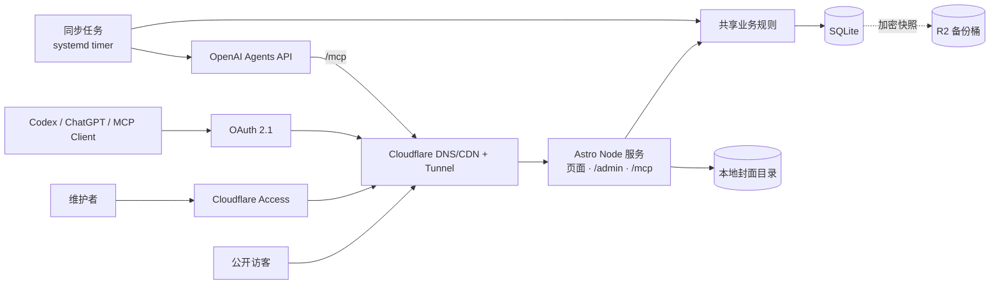

# fripSide Fan Site 技术文档

fripsi.de 是一个非官方的 fripSide 粉丝站：活动日历、音乐库（歌曲、版本、发行物、Live 歌单）、站内管理后台，以及受控的 AI/MCP 编辑能力。

## 文档导航

- [项目协作约定](../AGENTS.md)：独立 worktree、PR 与开发代理的共享规则。
- [代码与数据发布流程](./release-workflow.md)：staging 验收、release 分支与 rebase 发布、migration 规则、内容变更。
- [部署与运维](./oci-deployment.md)：OCI 主机、私有部署流水线、schema migration、环境配置、同步任务与安全响应。
- [测试环境](./staging.md)：测试站访问控制、更新方式和测试数据。
- [SQLite 备份与恢复](./sqlite-backups.md)：加密快照、R2 生命周期、恢复演练。
- [总体架构](./architecture.md)：系统边界、组件、请求流和关键技术选择。
- [数据模型](./data-model.md)：表结构、约束、状态与旧数据迁移。
- [管理后台与 MCP](./admin-and-mcp.md)：人工编辑流程、MCP 工具、权限与安全规则。
- [音乐库](./music-library.md)：歌曲、版本、发行曲目、Live 歌单、交叉查询和 CSV 导入。
- [专辑封面](./release-covers.md)：封面导入、存储与访问规则。
- [官方活动自动同步](./official-sync.md)：通过 OpenAI Agents API 检查官网公告、验证来源并发布。

## 已确定的决策

1. **每个环境的 SQLite 是唯一内容数据源。** Notion 只用于一次性导出旧数据；GitHub 只管理代码、migration 和导入脚本。
2. **自托管 Node 运行时。** Astro standalone 构建运行在 OCI 主机上，Cloudflare 只负责 DNS/CDN、Access 和 Tunnel。
3. **管理后台属于网站本身。** `/admin` 直接编辑活动、Setlist、专辑，并审核 AI 提案、查看审计记录。
4. **MCP 与网站同进程，入口独立。** `/mcp` 复用同一套业务规则和数据库，但有独立的 OAuth resource 与权限。
5. **AI 采用「提案优先」。** AI 先创建 `change_set`，预览后才能发布，不直接修改数据库行；自动同步的发布同样经过服务端证据校验。
6. **可信人工维护者直接保存。** 服务端仍执行权限、校验、乐观锁、幂等和审计；需要暂存时使用 `published = 0`。
7. **所有写操作可追踪。** 保存操作者、来源、变更前后数据、请求 ID 和时间。
8. **不向 AI 暴露 SQL、通用 HTTP 请求或硬删除工具。** 删除统一转为可恢复的归档。
9. **身份认证交给 Cloudflare Access/OAuth。** 不自行实现密码、找回或会话系统。
10. **内容更新不触发重新构建。** 发布即写入数据库，页面通过 SSR 读取最新数据。
11. **数据可迁移。** SQLite 兼容的简单表结构、仓库内顺序编号的 SQL migration，并提供 CSV 导入导出。
12. **音乐库区分作品与版本。** Live 演唱先关联作品；只有来源明确时才精确关联到具体录音或编曲版本。

## 架构摘要

## 核心原则

- 前台以浏览体验、移动端和可访问性为优先；后台以低学习成本和防误操作为优先。
- AI 能完成高频维护，但发布权必须可控。
- 业务规则在服务端执行，不能只依赖 AI 提示词或前端校验。
- 构建与部署失败不能影响已上线内容；schema 变更优先增量，执行前有快照。

## 不做的事

- 通用文章 CMS、用户注册或社区论坛（讨论区使用 Giscus）。
- 售票或支付。
- 站内 AI 聊天框。
- 多租户和复杂组织权限。
- 图片生成和大型媒体库。

## 后续候选

- 旧 slug 重定向。
- 更细的角色和审批人机制。
- 关注分类后的邮件/RSS 通知。
- 定期数据质量报告。
- MCP UI 预览组件，让 ChatGPT 内直接显示活动 diff。
- 站内基于 Responses API 的编辑助手；仍复用 MCP/业务服务，不新开绕过权限的写路径。
