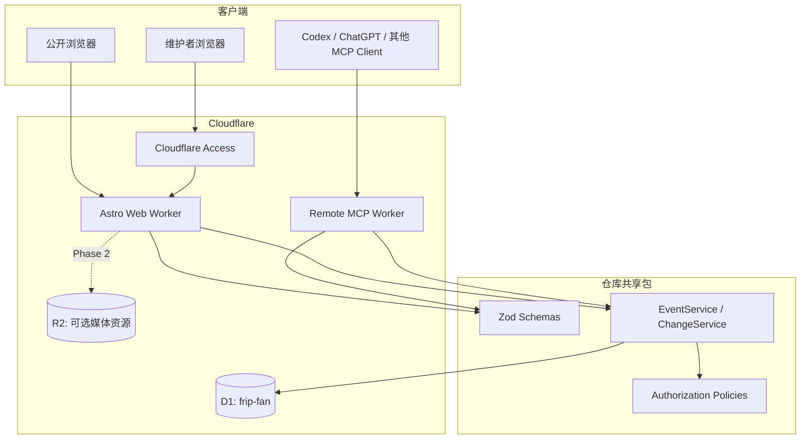
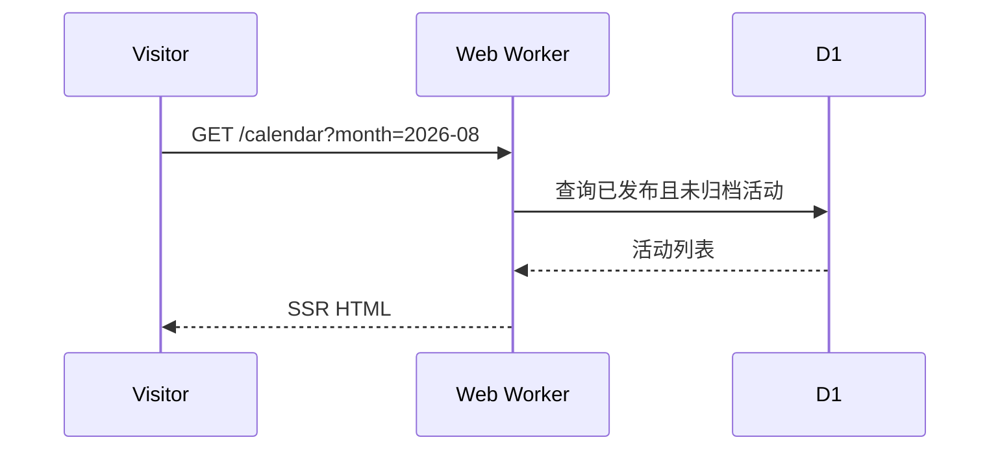
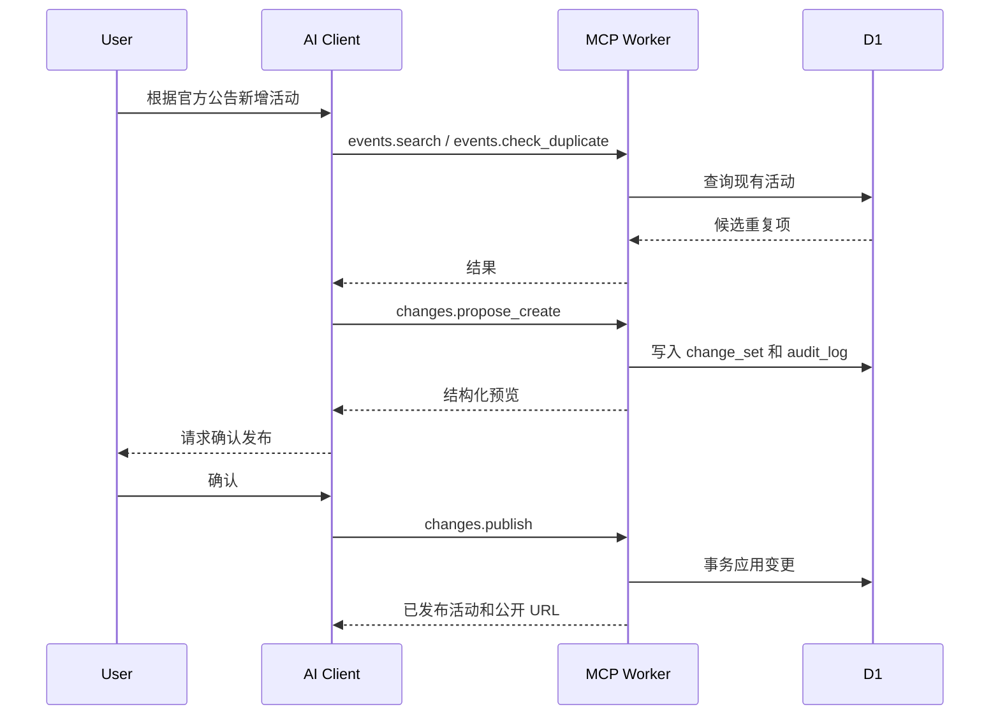

# 总体架构

## 1. 系统目标

系统同时服务三类使用者：

- 访客：浏览近期活动、月历、分类和历史档案。
- 维护者：通过 `/admin` 管理活动，无需编辑代码或数据库。
- AI 助手：通过 Remote MCP 查询、提出变更、预览并在授权后发布。

内容维护必须独立于 Notion、Google Sheets 等外部 CMS。代码仍由 GitHub 管理，内容存储在 D1，代码发布和内容发布互不耦合。

## 2. 组件关系



## 3. 仓库布局

计划采用 npm/pnpm workspace 风格的单仓库：

```text
frip-fan/
├── apps/
│   ├── web/                  # Astro SSR、公开页面、/admin 和 Web API
│   └── mcp/                  # Remote MCP Worker，Streamable HTTP /mcp
├── packages/
│   └── core/                 # Schema、业务服务、权限、共享类型
├── migrations/               # D1 SQL migrations
├── scripts/                  # 导入、导出、数据核验
├── docs/
└── wrangler.*.jsonc          # Web/MCP 的 Cloudflare 配置，或分别置于 app 内
```

`apps/web` 和 `apps/mcp` 不允许各自复制业务规则。所有日期、状态、来源、重复检查、发布和审计规则必须由 `packages/core` 提供。

## 4. Web Worker

### 4.1 公开页面

- `/`：下一场活动、近期活动、分类入口；没有未来活动时展示最近历史记录。
- `/calendar`：桌面月历，移动端默认时间线列表。
- `/calendar.ics`：由公开活动动态生成的完整 iCalendar 订阅源。
- `/archive`：按年份归档。
- `/events/:slug`：活动详情和来源。
- `/music`：歌单库总览与交叉统计。
- `/music/lives/:id`：某场 Live 的曲目顺序，并回链活动。
- `/music/releases/:slug`：发行曲目及歌曲/具体版本的 Live 出现次数。
- `/music/songs/:slug`：歌曲版本关系、发行位置和演唱历史。
- `/about`：制作人员、数据说明、非官方网站声明。

公开 UI 使用轻量的 Astro SSR 国际化层，支持 `zh-CN`、`zh-TW`、`ja` 和 `en`。服务端优先读取当前 URL 的 `lang` 参数，其次读取 `frip_fan_locale` Cookie，默认使用简体中文；语言选择器保留当前页面的其他查询参数，并把选择保存一年。HTML 响应设置 `Content-Language`，同时通过 `Vary: Cookie` 防止不同语言的 SSR 页面被错误共用缓存。当前只翻译导航、按钮、筛选器、状态、日期格式和空状态等 UI 文案，D1 中的活动、歌曲、专辑、场地与来源内容保持原文。

公开查询只能返回：

```sql
published = 1 AND archived_at IS NULL
```

### 4.2 管理页面

- `/admin`：概览和待处理变更。
- `/admin/events`：搜索、过滤和批量检查。
- `/admin/events/new`：人工创建活动。
- `/admin/events/:id`：人工直接编辑、公开/隐藏和归档。
- `/admin/music/setlists`：Setlist 列表、新建与完整曲序编辑。
- `/admin/music/releases`：专辑列表、新建与曲目编辑。
- `/admin/changes`：AI/MCP 创建的变更提案与审核。
- `/admin/audit`：审计记录。
- `/admin/data`：CSV 导入、导出和迁移检查。

`/admin/*` 与 `/api/admin/*` 必须由 Cloudflare Access 保护，服务端还要验证 Access JWT，不以“页面不可见”代替 API 鉴权。

## 5. MCP Worker

MCP 部署在独立域名，例如：

```text
https://mcp.example.com/mcp
```

采用当前标准的 Streamable HTTP transport。工具不需要保存对话状态，因此优先使用 Cloudflare `createMcpHandler()` 的无状态模式；只有未来确实需要服务器端会话、elicitation 或持久化 agent state 时才考虑 `McpAgent`/Durable Objects。

MCP Worker 只负责：

1. OAuth 认证和 scope 检查。
2. MCP 协议与工具 schema。
3. 将受控工具调用转交共享业务服务。
4. 返回结构化结果、预览和错误。

它不负责网页渲染，也不暴露数据库、任意 SQL 或任意网络请求能力。

## 6. 数据请求流

### 6.1 公开浏览



第一版不对动态 HTML 和活动 API 做长时间缓存，优先保证发布后立即可见。静态 CSS、JS、字体和图片继续由 Cloudflare 缓存。流量增长后再评估短 TTL 和精确失效。

### 6.2 AI 创建活动



## 7. 关键非功能要求

### 安全

- Admin 与 MCP 分别鉴权。
- 所有 D1 查询使用参数绑定。
- 发布、取消、下线和归档必须记录 audit log。
- MCP Token/OAuth Token 不写入日志或工具结果。
- 对来源 URL 做协议、长度和允许域校验；第一版不让 MCP 服务主动抓取任意 URL。

### 可靠性

- 所有写操作支持幂等键。
- 更新使用乐观锁 `expected_version`。
- 发布 change set 使用 D1 batch/事务语义，避免活动和审计记录部分成功。
- 数据库 migration 与应用部署分开执行。

### 可移植性

- 核心表使用 SQLite/D1 通用类型。
- 禁止将唯一业务逻辑放进 Cloudflare Dashboard。
- migrations、schema、导入导出脚本都进入 Git。
- 随时可以导出 CSV/SQL，在需要时迁往 SQLite 或 PostgreSQL。

## 8. 技术选择

| 领域 | 选择 | 原因 |
|---|---|---|
| Web | Astro SSR | 内容型网站、SEO、低前端 JS、支持 Workers binding |
| UI | Astro + 少量组件 | 避免为日历和后台引入整站 SPA |
| 数据 | Cloudflare D1 | 当前规模足够、SQLite 语义、与 Worker 原生绑定 |
| 校验 | Zod | Web、MCP、导入脚本共用 schema |
| 身份 | Cloudflare Access | 不自行实现密码系统 |
| MCP | Remote MCP / Streamable HTTP | Codex、ChatGPT 和其他 MCP Client 可复用 |
| 媒体 | R2（可选） | 图片需求明确后再启用 |

Astro 的 session API 当前未被使用；配置一个进程内 LRU driver 仅用于阻止 adapter 自动创建未使用的 KV namespace。身份与权限仍完全由 Cloudflare Access JWT 和服务端 scope 校验负责，不能把 LRU session 用作生产登录状态。

## 9. 明确不采用

- Notion 作为在线数据源。
- 浏览器端直接读取 D1 或携带数据库凭据。
- 每次内容修改后重新构建整个网站。
- MCP 通用 `execute_sql`、`fetch_url`、`delete_event` 工具。
- 在第一版实现站内聊天机器人；MCP 由已有 AI Client 调用即可。

## 10. 公开页面导航

首页、音乐库列表及详情、活动日历/搜索与活动详情、关于页统一使用 `SiteLayout` 中的 Astro `ClientRouter`。正常链接与 SSR 页面仍支持直接访问、分享和无 JavaScript 浏览；地图旅程、校准工具、讨论页和后台保留整页导航。`prefetch: false` 禁用预取，页面 HTML/CSS/脚本在导航时加载，搜索与加载更多的 API 请求继续由对应组件按需发起。

`public-navigation.ts` 只保存来源、列表入口及显式返回的滚动/焦点上下文，不抓取页面、不替换 DOM、不自行处理 popstate。页面替换、标题/元信息、样式与浏览器历史由 ClientRouter 管理。模块修改筛选 URL 时使用 `replacePublicUrl`，保留 Astro 的 history state 并同步正在显示的 URL；popstate 时地址已变，不能拿新地址保存旧页面的状态。活动搜索继续使用带内容版本与期限的快照恢复加载深度；音乐列表的累积页数保存在 URL。

组件在 `astro:page-load` 初始化，在 `astro:before-swap` 取消请求、监听器与定时器。公共布局避免导入音乐搜索模块，详情页进入列表时再加载所需脚本。新增公开交互时需验收首次访问、跨页进入及再次返回三种情况。来源返回位置的内存记录最多保留 40 个 URL，整页刷新或超出上限后使用正常链接及锚点退路。

公开导航的即时反馈由 `NavigationLoading` 与 `navigation-loading.ts` 统一管理。ClientRouter 在 `astro:before-preparation` 显示骨架/进度条，在 swap、取消、失败和 pageshow/pagehide 清理；不创建导航请求、不增加最短等待时间。音乐库切换保留 Tab 可操作，遮挡区域临时 inert，清理时恢复原属性。原生整页链接也显示反馈，取消原生加载时最多 15 秒恢复旧页面。骨架复用四语言 loading 文案，块状占位保持静态，仅顶部进度条使用一个 transform 动画，遵循 reduced-motion，避免每个占位块各自建立渐变动画合成层。

公共布局在 ClientRouter 之前同步加载同源带 hash 的 `router-bootstrap.js`，对当前 document 关闭原生 startViewTransition，使 Astro 初始化时选择已有的 `fallback="swap"` 分支；不覆盖全局导航，不改变服务器 URL，不为 CSP 开启 inline script。仅去掉命名快照时 Chromium 仍可能等待原生合成，因此不能只依赖 CSS。已打开的旧版本标签页在 DOM swap 后首次收到引导脚本时会刷新一次，让路由重新检测能力，避免把旧模块缓存的 native=true 与新 API 混用；新打开的页面保持局部导航。公共布局不对 body 添加 `transition:animate="none"` 的命名快照，html 使用 `view-transition-name: none`。仅将动画设为 none 仍会创建原生整页快照，在 WebKit 中可引入显著的合成等待；导航继续使用 ClientRouter，加载动画只发生在骨架上。验收 Safari 导航时应区分请求、after-preparation → after-swap 与 page-load 三段时序，不能用 Chromium 的手机 viewport 代替 WebKit 检查。

手机导航使用显式 hidden 的 role=dialog 对话层，背景通过 inert 暂停交互，手动管理 Tab/Escape/焦点恢复，避免 iPhone Safari 原生 modal top-layer 关闭或命中异常。菜单链接捕获阶段与 Astro before-preparation 捕获阶段立即关闭菜单，先恢复背景 inert，再让加载反馈接管；before-swap 仍兜底清理。菜单控制器重建前必须先清理旧状态。路由引导资源 URL 携带公开 release SHA，让不同发布的已持久化布局监听器在一次正常刷新后统一初始化，避免新旧菜单实现混用。

导航真机诊断只在 staging/development 公共布局提供：用 `?navDebug=1` 显式开启，当前标签页通过 sessionStorage 保持启用；面板的关闭按钮或 `?navDebug=0` 停止。默认不加载诊断模块；生产不输出诊断入口。面板记录最多 200 条触摸/点击（含 dispatch delay）、Astro 五阶段、同源 Resource Timing 和交互期间超过 100ms 的 rAF 间隔，可手动复制记录，不发送遥测。URL 仅保留 pathname，不记录查询值、fragment、Cookie、请求头或请求/响应内容。rAF 条目仅表示回调执行时间，不等同于屏幕实际呈现时间。诊断不拦截事件、不替换 loader/swap、不改变导航策略；显式启用期间对 `fetch`、`Response.text` 和 `DOMParser.parseFromString` 添加转发原接收者/参数的计时包装，用于区分响应正文读取与同步 HTML 解析，关闭时恢复原方法且不覆盖其他代码随后安装的包装；不导出 HTML 内容；增加低频定时器间隔记录，辅助区分 rAF 暂停与整个事件循环的停顿；真实 Safari 的停顿仍须根据记录定位，不能把诊断功能当作性能修复。

真机加载反馈对照只随显式诊断启用：`?navDebug=1&navLoading=off` 跳过加载遮罩、inert 和 visibility 处理，但保留 Astro 局部导航；`navLoading=on` 恢复静态骨架与单个进度条。选择只保存在当前标签页，复制记录包含 `loadingFeedback`，跨 DOM swap 保持，关闭诊断时清理。此对照用于验证 Safari 浏览器侧停顿是否由加载反馈的绘制/交互状态触发，不把本地结果当成真机修复证明。
